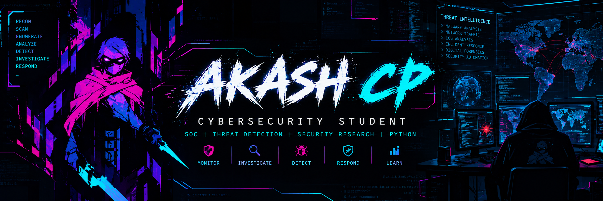

<div align="center">



<a href="https://readme-typing-svg.demolab.com">
  
</a>

<p>
  <a href="https://github.com/Akashcp111"></a>
  <a href="https://www.linkedin.com/in/akash-cp-a943142a2/"></a>
  <a href="https://akashcp.dev"></a>
</p>

</div>

---

## `> whoami`

```bash
Name       : Akash CP
Focus      : Cybersecurity | SOC Analysis | Threat Detection
Interests  : Blue Team | Network Security | Security Automation
Languages  : Python | C | JavaScript
Goal       : Build practical skills in monitoring, investigation, and incident response
```

I'm a cybersecurity student who enjoys building security tools, investigating network activity, and exploring how defenders detect and respond to threats. I'm especially interested in SOC operations, intrusion detection, Python automation, and hands-on security labs.

I believe in learning by building: documenting experiments, improving tools, and turning cybersecurity concepts into practical projects.

## `> cat current_focus.yaml`

```yaml
blue_team:
  - Security monitoring and log analysis
  - Network traffic and intrusion detection
  - Threat investigation fundamentals
  - Incident response workflows

security_development:
  - Python security automation
  - Network scanning and reconnaissance
  - Web application security testing
  - Machine-learning-assisted threat detection
```

## `> ls ~/projects`

| Project | What it does | Technologies |
|---|---|---|
| [Python Port Scanner](https://github.com/Akashcp111/Python-Port-Scanner) | Python utility for scanning ports and exploring network services | `Python` |
| [Automated Web Exploitation Bot](https://github.com/Akashcp111/Automated-Web-Exploitation-Bot) | Web security testing workflow with crawling, fuzzing, and a dashboard | `Python` |
| [Enigma](https://github.com/Akashcp111/Enigma) | IoT security toolkit exploring wireless and embedded-device security | `C++` · `ESP32` |
| [CTF Platform](https://github.com/Akashcp111/app) | Capture-the-flag platform application | `JavaScript` · `Web` |
| **ML-IDS** | Machine-learning-enhanced intrusion detection project using network security data and detection workflows | `Python` · `Scikit-learn` · `Pandas` · `Snort` · `Streamlit` |

> **ML-IDS repository:** Add the direct repository URL to this row when you have it. The current profile URL is not necessarily the project's repository.

## `> cat tech_stack.txt`

<div align="center">
  
</div>

| Area | Tools and skills |
|---|---|
| Security | Nmap · Wireshark · Snort · Burp Suite · OWASP ZAP |
| Blue Team | Log analysis · Intrusion detection concepts · Threat monitoring · Incident response fundamentals |
| Development | Python · C · JavaScript · Streamlit |
| Data & ML | Pandas · Scikit-learn · Random Forest · Data preprocessing |
| Platforms | Linux · Windows · Docker · Git · GitHub |

## `> ./learning.sh`

- Building practical SOC and defensive security skills
- Practising network analysis and web application security in authorized labs
- Improving Python scripting and security automation
- Learning to document findings clearly and reproducibly

## `> ./certifications.sh`

- Google Cybersecurity Certificate
- Blue Team Fundamentals (BTF)
- Certified Cyber Security Analyst (C3SA)
- Certified Penetration Tester (CPent)
- Ethical Hacking Essentials (EHE) — EC-Council

## `> ./github_stats.sh`

<div align="center">

<a href="https://github.com/Akashcp111">
  
</a>

<p>
  <a href="https://github.com/Akashcp111?tab=repositories">
    
  </a>
  <a href="https://github.com/Akashcp111?tab=stars">
    
  </a>
</p>

</div>

> **Note:** GitHub stats cards can temporarily fail when third-party services are rate-limited or unavailable. I’ve removed the cards that were showing broken-image icons and expanded the working streak card to use the full available width.

## `> ./connect.sh`

I'm interested in connecting with cybersecurity learners, SOC professionals, open-source contributors, and teams working on defensive security.

- **GitHub:** [@Akashcp111](https://github.com/Akashcp111)
- **LinkedIn:** [Akash CP](https://www.linkedin.com/in/akash-cp-a943142a2/)
- **Portfolio:** [akashcp.dev](https://akashcp.dev)

<div align="center">
  

  <br/>
  <sub><code>ACCESS GRANTED // KEEP LEARNING · STAY CURIOUS · DEFEND THE DIGITAL WORLD</code></sub>
</div>
